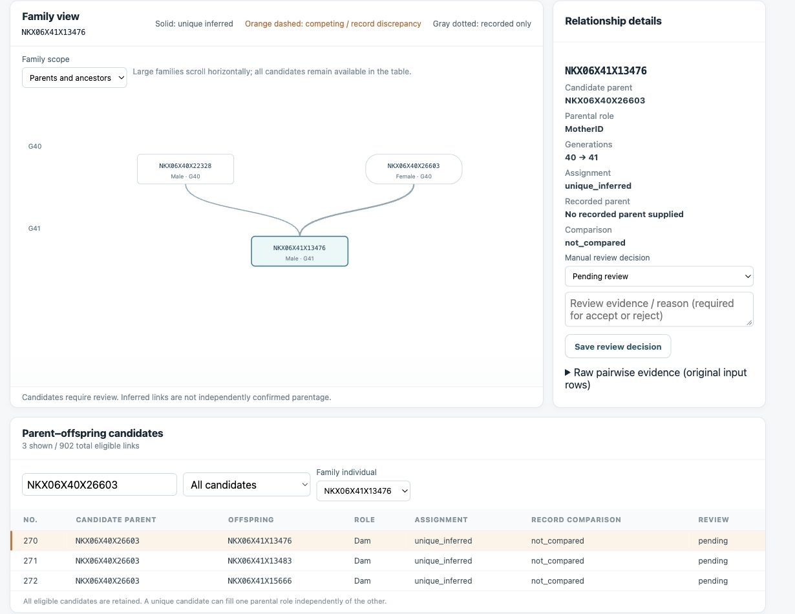

# duckPI

**Version 2.0.1** — genomic relationship organization and interactive pedigree review.

The command line and browser interface share one Python analysis engine. duckPI retains single-parent information, preserves competing parental candidates and their original evidence, and supports comparison with independently supplied breeding records.

## Quick start

Python 3.9 or later is required. The review engine, local interface and complete example runner use only the Python standard library. No web framework, internet connection, KING executable or Graphviz installation is needed for these features.

```bash
# Run from the directory containing duckPI.py.
python3 run_example.py
python3 duckPI.py --serve
```

Open **http://127.0.0.1:8765/**. Select:

- `example_data/pairwise_relationships.tsv`
- `example_data/individuals.tsv`
- An independent recorded pedigree, if available (optional).

Click **Analyze tables**. Files stay on this computer. The service binds only to loopback; use the printed IP address and stop with Ctrl+C.

## Complete worked example

The bundled example contains the supplied **711 real NKX individual identifiers**, complete sex and generation metadata, **252,405 unordered pairwise relationships**, and the complete **153,117-SNP PLINK binary dataset**. IDs such as `NKX06X40X26603` are preserved without substitution.

```bash
python3 run_example.py
```

This validates sample IDs, metadata completeness, all unordered pairs, upstream output coverage, BED/BIM/FAM dimensions and input checksums. It then runs both KING-call and PLINK-call pedigree organization. It does not rerun the estimator executables. Generated outputs are included for inspection:

| Output | Purpose |
|---|---|
| [KING review](example_data/results/king_review.html) | Offline interactive family report |
| [PLINK review](example_data/results/plink_review.html) | Offline interactive family report |
| [Validation report](example_data/results/validation.json) | Input checks, counts, focused relationships and SHA-256 hashes |
| `example_data/results/*_pedigree.tsv` | Complete inferred pedigrees and per-role status |
| `example_data/results/*.candidates.tsv` | All eligible candidates and original evidence |
| `example_data/results/*.review.json` | Complete portable results for the interface |

Both reports open on a relationship involving **NKX06X40X26603**, a female from generation 40, and offspring **NKX06X41X13476**. The supplied KING evidence for this pair is `Kinship = 0.2451`, `KING = 0.4902`, `Z0 = 0.0`; `PI_HAT = 0.5`. These are measured input values, not substituted theoretical kinship values.

The example yields 902 eligible PO candidates under each selected method. No independent farm pedigree is bundled, so record recovery and additional-link counts are **not assessed**. Neither 895/897 nor seven additional links is hard-coded. The original `.fam` has missing parent and sex fields; complete sex information is supplied separately in `individuals.tsv`. Missing `.fam` fields are not treated as an independent farm pedigree.



The screenshot shows the complete input analysis filtered to NKX06X40X26603. It does not establish an unrecorded farm relationship without a reference pedigree.

See the [example data inventory](example_data/README.md) and [user guide](docs/USER_GUIDE.md).

## Command-line analysis

```bash
python3 duckPI.py --make-king \
  --file example_data/pairwise_relationships.tsv \
  --extrainfo example_data/individuals.tsv \
  --id NKX06X40X26603 \
  --out results/king_pedigree.tsv --review results/king_review.html
```

Use `--make-plink` to select PLINK calls. Add `--recorded farm_pedigree.tsv` to compare an independent pedigree. Add `--serve` to launch the interface with the current result loaded. `--port 8766` selects a different port.

`--id` sets the report's initial focus. When that individual has candidate offspring, the first matching family is displayed; all candidate links remain in the report and are searchable.

For an output `results/pedigree.tsv`, the CLI also writes `.candidates.tsv`, `.issues.tsv`, `.record_checks.tsv` and `.review.json` sidecar files. The optional HTML report is standalone and can be opened offline. Offline pages can open review JSON files; start the server to analyze new CSV/TSV input.

## Input formats

UTF-8 CSV and TSV are detected from their headers. Identifiers are strings; leading zeros and names such as `NA` are preserved in individual and pairwise IDs.

| Input | Required columns |
|---|---|
| Individuals | `ID`, `Sex`, `Generation` |
| KING calls | `ID1`, `ID2`, `KING_Relation` |
| PLINK calls | `ID1`, `ID2`, `PI_HAT_Relation` |
| Recorded pedigree (optional) | `ChildID`, `FatherID`, `MotherID` |

Sex values: `1`/`Male`/`M`, `2`/`Female`/`F`, or `0`/`-9`/`Unknown`/blank. Generation must be finite numeric and increase from parent to offspring; earlier nonadjacent generations are allowed. Individual IDs must be unique.

Relationship labels: `PO`, `FS`, `2nd`, `MZ`, `UN`. Explicit calls take precedence. Without calls, KING requires `KING` and `Z0`, or `Kinship` and `Z0`; PLINK requires `PI_HAT` and `Z0`. `KING` means **2 × KING Kinship**. PO uses the inherited rule `2^(-3/2) < KING or PI_HAT <= 2^(-1/2)` and `Z0 < 0.1`. Numeric KING classification therefore also needs PLINK-derived Z0; it is not a KING-only classifier. Missing numeric evidence does not become a PO call. These thresholds are inherited, not newly calibrated for other populations.

Missing values in recorded parent fields: blank, `0`, `-9`, `NA`, `N/A`, `nan`, `None`, `.`. Each recorded child can appear once. A recorded parent need not be genotyped.

## Assignment and review rules

1. Orient PO pairs by generation and determine sire/dam role from parental sex.
2. Assign a role only when it has one eligible candidate (`unique_inferred`). A missing mother never erases an inferred father, and vice versa.
3. Retain every competing candidate when a role has multiple eligible parents (`ambiguous`); leave that parent ID unresolved. Input order and score ranking do not break ties.
4. Retain every metadata individual, including founders and isolated individuals.
5. Group reversed/duplicate pair rows while preserving all source rows and evidence. Exclude conflicting duplicate calls, self pairs, missing metadata, same-generation PO pairs and unknown parental sex, with reasons in the issues table.
6. Compare supplied breeding records separately: `recorded_match`, `unrecorded_role`, `child_not_recorded`, `recorded_conflict`. Without a reference, use `not_compared`. Recorded links lacking eligible support under the selected method are `not_supported`, which does not prove an incorrect record.

A unique inferred parent remains a candidate. duckPI does not perform global pedigree optimization, Mendelian-consistency testing or independent parentage confirmation.

The interface supports candidate filtering, family selection, a parents/offspring scope selector, raw evidence inspection, manual review notes and SVG/TSV/JSON exports. Accept/reject requires a reason; two candidates cannot both be accepted for the same child and role. **Export review JSON before closing, reloading or analyzing another dataset.** Decisions live in page memory and are restored by importing that JSON. Inferred assignments and manually accepted assignments have separate exports; original records are not overwritten.

## External estimators

The five-estimator study comparison (PLINK, KING, GRM, Ukin, Kindred) is an upstream analysis, not five built-in executable backends. duckPI directly invokes KING and PLINK. Import preclassified calls from other methods using an explicitly named column:

```bash
python3 duckPI.py --make-external --relation-column Ukin_Relation \
  --file upstream_calls.tsv --extrainfo individuals.tsv \
  --out results/ukin.tsv --review results/ukin.html
```

External calls must be explicit. duckPI does not apply KING/PLINK thresholds to arbitrary external numeric scales. Include estimator provenance and evidence in the input fields.

## Optional genotype estimation and PNG rendering

Install optional dependencies in an isolated environment:

```bash
python3 -m venv .venv
. .venv/bin/activate
python -m pip install -r requirements.txt
```

Place compatible `king` and `plink` executables in `bin/`. The bundled archives are **Linux x86_64**, not macOS executables. `bash install.sh` unpacks them and installs requirements in the active environment. PNG drawing additionally requires the system Graphviz `dot` executable.

```bash
python duckPI.py --kinship --file example_data/IndepSNP1 --out results/merged.tsv
python duckPI.py --make-king --file results/merged.tsv \
  --extrainfo example_data/individuals.tsv --out results/pedigree.tsv
python duckPI.py --draw_pedigree --id NKX06X41X13476 \
  --pedigree results/pedigree.tsv --extrainfo example_data/individuals.tsv
```

Estimator binaries resolve relative to `duckPI.py`; intermediate estimator files go under `data/` in the working directory. Pair orientation is normalized before merging; duplicate unordered estimator rows must be resolved first. PNGs show assigned links; HTML/SVG also show competing candidates.

## Tests and release layout

```bash
python3 -m unittest discover -s tests -v
# Optional UI logic checks, Node.js 18+
node tests/test_web.cjs
```

Regression tests cover independent parental roles, ambiguity, evidence retention, records, external calls, input validation, exports, estimator-result merging and the local API. Synthetic edge cases are isolated under `tests/fixtures/synthetic`; they are not the worked example or manuscript evidence. Public-facing documentation, software text and data headers are English.

See [release notes](CHANGELOG.md). Full example results record exactly which inputs were used and which analysis steps were rerun.
